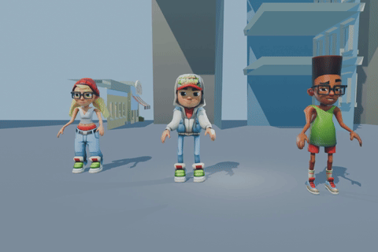
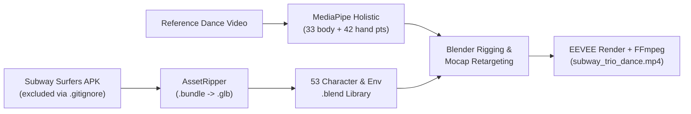

<h1 align="center">Subway Surfers 3D: Character Library & Motion Capture</h1>

<p align="center">
  
  
  
  
  
</p>

<p align="center">
  <b>3D character models, environment assets, and a video-to-Blender motion capture pipeline built from Subway Surfers (v3.71.11).</b>
</p>

---

## Preview

<p align="center">
  <a href="subway_trio_dance.mp4">
    
  </a>
</p>

<p align="center">
  <a href="subway_trio_dance.mp4"><b>Watch Full Video with Audio (864x576, 25fps, H.264 + AAC)</b></a>
</p>

---

## Highlights

|                                                                                                     |                                                                                                 |                                                                                                  |
| :-------------------------------------------------------------------------------------------------: | :---------------------------------------------------------------------------------------------: | :----------------------------------------------------------------------------------------------: |
| **53 Characters**<br/>Ready-to-open `.blend` files for Jake, Tricky, Fresh, Yutani, Spike, and more | **Subway Environment**<br/>Train wagons, city buildings, and station pillars as `.blend` assets | **Video-to-3D Mocap**<br/>MediaPipe Holistic 3D body & hand tracking retargeted to Blender rigs  |
|        **Wiggle 2 Physics**<br/>Secondary bone spring dynamics and mesh-level foot grounding        |       **Cinematic Camera**<br/>4-part dynamic camera synced to the original dance rhythm        | **Clean Pipeline**<br/>Reproducible Python & Blender scripts with APKs excluded via `.gitignore` |

---

## Pipeline Overview



---

## Repository Structure

```text
.
├── blender/
│   ├── characters/                  # 53 individual Subway Surfers characters (.blend)
│   ├── environment/                 # Train wagons, city buildings, station pillars (.blend)
│   └── scenes/
│       └── subway_trio_dance.blend  # Full animated Tricky + Jake + Fresh dance scene
├── scripts/
│   ├── extract_pose.py              # MediaPipe Pose 3D landmark extractor
│   ├── extract_holistic.py          # MediaPipe Holistic (body + hands) extractor
│   ├── glb_holistic_dance.py        # Blender rigging, mocap retargeting, camera & lighting
│   └── export_all_blends.py         # Batch GLB to .blend converter
├── preview.gif                      # Animated preview of the rendered dance
├── subway_trio_dance.mp4            # Full rendered 864x576 @ 25fps dance video
└── .gitignore                       # Excludes APKs, raw binaries, and intermediate dumps
```

---

## Quick Start

1. **Browse Characters:** Open any `.blend` file in `blender/characters/` (such as `jake.blend`, `tricky.blend`, or `fresh.blend`) directly in Blender.
2. **Open the Dance Scene:** Open `blender/scenes/subway_trio_dance.blend` in Blender, switch to **Material Preview**, and press `Space` to play.
3. **Re-run the Pipeline:** Use the scripts in `scripts/` with Python 3.12 (`uv run --with mediapipe --with opencv-python-headless`) and Blender 5.2+.

---

## Credits & Acknowledgments

- **Subway Surfers:** All game characters, 3D models, textures, and environment assets are the intellectual property of **SYBO Games ApS** and **Kiloo**. This repository is strictly for educational and non-commercial research purposes.
- **Blender:** [blender.org](https://www.blender.org/) (3D rigging, animation, and EEVEE rendering)
- **AssetRipper:** [AssetRipper/AssetRipper](https://github.com/AssetRipper/AssetRipper) (Unity Addressables extraction)
- **MediaPipe:** [google-ai-edge/mediapipe](https://github.com/google-ai-edge/mediapipe) (3D body and hand pose estimation)
- **Wiggle 2:** [shteeve3d/blender-wiggle-2](https://github.com/shteeve3d/blender-wiggle-2) by Steve Miller (secondary bone spring physics)
- **REA (Reverse Engineer Anything):** IL2CPP metadata and Android resource analysis
- **UnityPy, JADX, Apktool, and FFmpeg**

---

## License

This project is released for **educational and non-commercial research purposes only**. See [LICENSE](LICENSE) for full details. All Subway Surfers characters, models, and environment assets remain the property of **SYBO Games ApS** and **Kiloo**.
